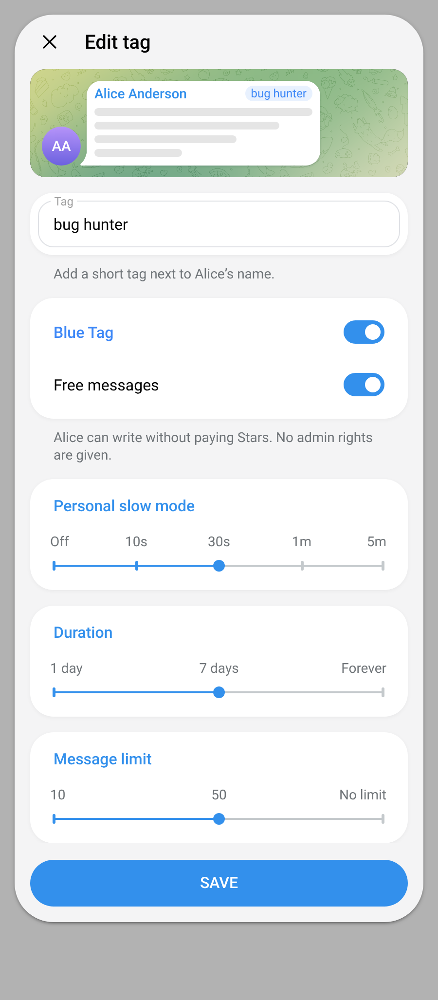

# Blue Tag — Telegram concept by @information_balfikovich

**Blue Tag** is a new kind of member tag for supergroups with paid messages. An admin gives a member a blue tag, and with it:

- **free messages** in a group where everyone else pays Stars;
- **a personal slow mode** that applies to this member only;
- **a time limit** (1 day, 7 days, forever) or **a message limit** (10, 50, no limit).

No admin rights are given. When the perks run out, the tag stays and turns gray again.

| Tag | Color | Pays | Slow mode | Admin rights |
|---|---|---|---|---|
| Owner | purple | no | no | all |
| Admin | green | no | no | yes |
| Member | gray | yes | chat-wide | no |
| **Blue** | **blue** | **no** | **personal** | **no** |



## What's in the repository

| Path | Contents |
|---|---|
| [`SPEC.md`](SPEC.md) | API, server behaviour, client behaviour, strings |
| [`api/blue_tag.tl`](api/blue_tag.tl) | TL schema of the new and changed constructors (layer 233). IDs are CRC32, computed like the official ones |
| `api/*.py` | Patch `api.tl` (Desktop, Web A, iOS) and the JSON schema (Web K) with Blue Tag; check the CRC32 IDs |
| `clients/*.patch` | The implementation for each official client |
| `scripts/apply.sh` | Clones a client at the commit the patch was made against and applies it |

## Clients

| Client | Patch | What it does | Checked here |
|---|---|---|---|
| **Telegram Web A** (telegram-tt) | `web-a.patch` | TL, types, API method, action, Blue Tag section in Edit Tag, blue badge in messages, free sending, placeholder `Free · N left`, personal slow mode, message counter | `tsc`, eslint, stylelint, unit tests (TL round-trip + logic), Vite build |
| **Telegram Web K** (tweb) | `web-k.patch` | Same, plus Recent Actions entries and the Tag Info popup | `tsc`, unit tests, rendered in the popup sandbox (screenshot above) |
| **Android** | `android.patch` | TLRPC classes (old constructors still parse), Blue Tag section in the tag sheet, blue tag in bubbles, free sending, placeholder, personal slow mode | syntax check (the app is built with the Android SDK) |
| **iOS** | `ios.patch` | `swift_scheme.tl`, `TelegramChannel.tagPerks` (Postbox + FlatBuffers), engine methods, Blue Tag section in the tag sheet, blue tag in bubbles, free sending, placeholder, personal slow mode | syntax check (the app is built with Xcode/Bazel) |
| **macOS** (telegram-macos) | `macos.patch` + `ios.patch` in `submodules/telegram-ios` | Blue Tag section in the member screen, blue badge in messages and in Tag Info, free sending, placeholder `Free · N left`; data and API come from TelegramCore (`ios.patch`), personal slow mode too | syntax check (the app is built with Xcode) |
| **Desktop** (tdesktop) | `desktop.patch` | `api.tl`, `ChannelData` perks, Blue Tag section in Edit tag, blue badge, free sending, personal slow mode | syntax check (the app is built with Qt and its submodules) |

The patch for each client is made against the latest commit at the time of writing (see `scripts/apply.sh`).

## Apply

```bash
scripts/apply.sh web-a        # or web-k, android, ios, desktop, macos
cd web-a && npm ci && npm run dev
```

The script makes a `blue-tag` branch with one commit, ready to push to a fork.

Tests (Web A ignores its `tests/` folder in git, so create the setup file first):

```bash
cd web-a && mkdir -p tests && echo 'export {};' > tests/init.ts
npx cross-env APP_ENV=test npx vitest run src/lib/gramjs/tl/blueTag.test.ts src/global/helpers/blueTag.test.ts   # 9 tests
cd web-k && npx vitest run src/tests/blueTag.test.ts src/tests/memberTag.test.ts                                  # 18 tests
```

### Trying it without server support

The server does not know `channels.editMemberTagPerks` yet. In Web A the UI can be tried locally:

```js
localStorage.setItem('tt-blue-tag-emulation', '1')     // the admin's Edit Tag saves the perks locally
blueTag.setMyPerks('-100…', { isFreeMessages: true, slowModeSeconds: 5, messagesLimit: 50 })  // a member's own perks
```

---

## По-русски

**Синий тег** — новый тег участника для групп с платными сообщениями. Админ выдаёт его через «Изменить тег» — так же, как обычные теги. С ним участник:

- пишет бесплатно;
- получает личный КД;
- может получить тег на время (1 день, 7 дней, навсегда) или на N сообщений (10, 50, без лимита).

Прав админа тег не даёт. Когда срок или лимит заканчивается, тег остаётся, но снова становится серым.

В репозитории:

- **спецификация API** с TL-схемой: ID посчитаны тем же CRC32, что и у Telegram;
- **патчи для 6 официальных клиентов**: Web A, Web K, Android, iOS, Desktop и macOS;
- **скрипт `scripts/apply.sh`**: он клонирует клиент на нужном коммите, накладывает патч и создаёт ветку `blue-tag`.

Web A и Web K собраны и проверены здесь: tsc, тесты, сборка, скриншот. Android, iOS, Desktop и macOS проверены на синтаксис: для их сборки нужны Android SDK, Xcode и Qt.

Concept & idea: **@information_balfikovich** · made with Claude
